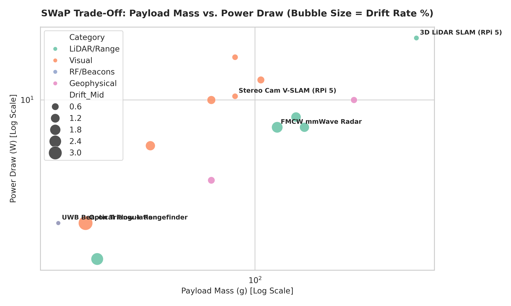
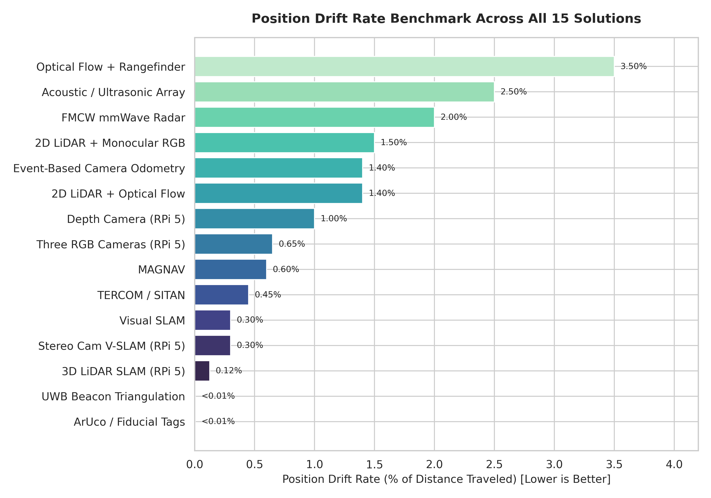

# Research Overview

Why this project exists and how the design was chosen. To fly the drone, see [QUICKSTART.md](QUICKSTART.md).

## The research docs

| Doc | What's in it |
| :--- | :--- |
| [PROBLEM_STATEMENT.md](PROBLEM_STATEMENT.md) | The problem, the math, and the target numbers (KPIs) |
| [OBJECTIVES.md](OBJECTIVES.md) | What the system must do |
| [SOLUTIONS.md](SOLUTIONS.md) | 15 ways to navigate without GPS |
| [ANALYSIS_SOLUTIONS.md](ANALYSIS_SOLUTIONS.md) | Those 15 compared with numbers and scores |
| [BOM.md](BOM.md) | Parts list and prices for the design target |
| [TIMELINE.md](TIMELINE.md) | Plan and progress |

## The design target

The analysis picked a **stereo camera + Raspberry Pi 5 + PX4** drone that does everything onboard:

| Part | Choice |
| :--- | :--- |
| Compute | Raspberry Pi 5 (8 GB): depth, visual SLAM, costmaps |
| Flight controller | Holybro Kakute H7 running PX4 |
| Main sensor | SC132GS stereo camera (+ IMU on the flight controller) |
| Software | ROS 2 Humble, Nav2, ORB-SLAM3 / VINS-Fusion, OpenCV |
| Pilot link | RadioMaster ELRS (manual override) |

The **current prototype** is different: a Pixhawk with ArduPilot, and the Pi streams data to a
laptop that does the processing. See the [README](../README.md#how-the-current-system-works).

## Best choice per mission

From the scoring in [ANALYSIS_SOLUTIONS.md](ANALYSIS_SOLUTIONS.md):

| Mission | 1st | 2nd | 3rd |
| :--- | :--- | :--- | :--- |
| Defense / jammed airspace | mmWave radar | 3D LiDAR SLAM | Event camera |
| Underground inspection | 3D LiDAR SLAM | mmWave radar | Depth camera (IR) |
| Tiny drone (< 250 g) | Optical flow + rangefinder | UWB beacons | ArUco tags |

## Charts




<details>
<summary>All 12 charts (in <code>benchmarking/</code>)</summary>

| # | Chart |
| :--- | :--- |
| 1 | Size/weight/power trade-off (bubble = drift) |
| 2 | Drift rate |
| 3 | Hardware cost (INR) |
| 4 | Robustness heatmap |
| 5 | Drift vs cost |
| 6 | Drift vs payload |
| 7 | Total robustness ranking |
| 8 | Cost by category |
| 9 | Radar profiles |
| 10 | Update rate vs drift |
| 11 | Range vs drift |
| 12 | Top-3 scores per mission |

</details>

To regenerate them:

```bash
pip install pandas matplotlib seaborn
python3 scripts/analysis.py
```
